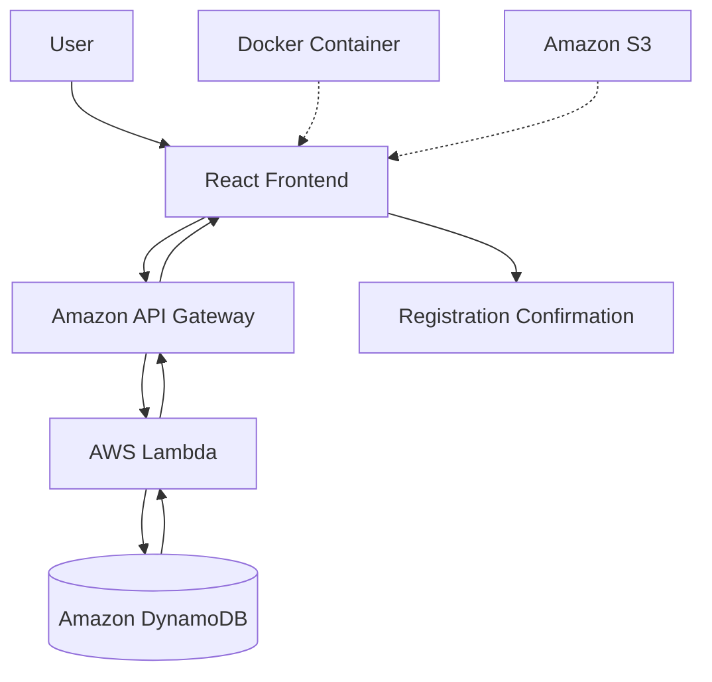

# 🎟️ EventEase
### Cloud-Based Event Registration & Ticket Management System

<p align="center">
  <b>Discover Events. Register Seamlessly. Manage Everything in the Cloud.</b>
</p>

<p align="center">
  
  
  
  
  
</p>

---

## 🌟 About the Project

**EventEase** is a cloud-based event registration and ticket management application designed to simplify the process of discovering events and registering for them.

The application provides an interactive React frontend connected to a serverless AWS backend. Users can browse available events, search and filter event listings, submit registration details, and receive a registration confirmation with a unique registration ID.

By leveraging AWS cloud services and Docker containerization, EventEase demonstrates a scalable and modular approach to building modern cloud applications.

## ✨ Key Features

- 🎫 **Event Discovery:** Browse available events through an interactive interface.
- 🔎 **Search & Filtering:** Find events using search and category filters.
- 📝 **Online Registration:** Register for events by submitting participant details.
- 🆔 **Unique Registration ID:** Generate a unique ID for every successful registration.
- ☁️ **Cloud Database:** Store event and registration information in Amazon DynamoDB.
- ⚡ **Serverless Backend:** Process requests using AWS Lambda.
- 🔗 **REST API Integration:** Connect frontend and backend through Amazon API Gateway.
- 🐳 **Docker Support:** Build and run the frontend in a Docker container.
- 📱 **Responsive UI:** Access the application across different screen sizes.

## 🏗️ System Architecture



### 🔄 Application Workflow

1. The user opens the EventEase frontend.
2. The React application requests event information from API Gateway.
3. API Gateway forwards the request to AWS Lambda.
4. Lambda retrieves event data from DynamoDB.
5. The user selects an event and submits the registration form.
6. Lambda validates the registration details and stores the record in DynamoDB.
7. The application displays a confirmation with a unique registration ID.

## ☁️ AWS Services Used

| AWS Service | Purpose |
|---|---|
| Amazon S3 | Static website storage and hosting setup |
| AWS Lambda | Serverless backend processing |
| Amazon API Gateway | HTTP API endpoints |
| Amazon DynamoDB | Event and registration data storage |

**AWS Region:** Asia Pacific (Sydney) — `ap-southeast-2`

## 🛠️ Technology Stack

| Layer | Technologies |
|---|---|
| Frontend | React.js, JavaScript, CSS, Vite |
| Backend | Python, AWS Lambda, Boto3 |
| Cloud | AWS S3, Lambda, API Gateway |
| Database | Amazon DynamoDB |
| Containerization | Docker, Dockerfile, Nginx |
| Version Control | Git, GitHub |

## 🐳 Docker Setup

The frontend includes a multi-stage Dockerfile that builds the React application using Node.js and serves the production build through Nginx.

### Build the Docker Image

```bash
cd eventease-frontend
docker build -t eventease-frontend .
```

### Run the Container

```bash
docker run -d -p 8080:80 --name eventease-container eventease-frontend
```

Open the application:

```text
http://localhost:8080
```

### Stop and Remove the Container

```bash
docker stop eventease-container
docker rm eventease-container
```

## 🚀 Run Locally

### Prerequisites

- Node.js and npm
- Python (for backend development)
- AWS account
- Docker Desktop (optional, for containerization)

### 1. Clone the Repository

```bash
git clone https://github.com/PiyaliChoudhury/EventEase.git
cd EventEase
```

### 2. Start the Frontend

```bash
cd eventease-frontend
npm install
npm run dev
```

Open:

```text
http://localhost:5173
```

### 3. Backend

The backend is implemented as an AWS Lambda function using Python and Boto3. It interacts with DynamoDB through the configured AWS execution role.

Backend source:

```text
eventease-backend/lambda_function.py
```

## 🔗 API Endpoints

**Base URL:**

```text
https://2vz56w2bob.execute-api.ap-southeast-2.amazonaws.com
```

| Method | Endpoint | Description |
|---|---|---|
| GET | `/events` | Retrieve available events |
| POST | `/register` | Register a participant for an event |

### Registration Request Example

```json
{
  "participantName": "John Doe",
  "email": "john@example.com",
  "phone": "9876543210",
  "eventId": "EVT001"
}
```

## 📁 Project Structure

```text
EventEase/
│
├── eventease-backend/
│   └── lambda_function.py
│
├── eventease-frontend/
│   ├── public/
│   ├── src/
│   │   ├── assets/
│   │   ├── App.jsx
│   │   ├── App.css
│   │   ├── index.css
│   │   └── main.jsx
│   │
│   ├── Dockerfile
│   ├── .dockerignore
│   ├── package.json
│   ├── package-lock.json
│   └── vite.config.js
│
├── .gitattributes
└── README.md
```

## 🔮 Future Enhancements

- Secure user authentication and authorization.
- QR-code-based digital tickets.
- Online payment gateway integration.
- Automated email confirmations.
- Event organizer dashboard.
- Real-time seat availability and booking management.
- CI/CD pipeline for automated deployment.

## 👩‍💻 Contributors

**Project Developer**

- **Piyali Choudhury** — [@PiyaliChoudhury](https://github.com/PiyaliChoudhury)
- **Sree Chetana** - [@SreeChetana](https://github.com/SreeChetana)

**Collaborator**

- Add your collaborator's name and GitHub profile here: `@GitHubUsername`

Contributions, suggestions, and improvements are welcome!

## 📌 Project Information

**Project Name:** EventEase  
**Category:** Cloud Computing / Web Application  
**Architecture:** Serverless Cloud Architecture  
**Repository:** [GitHub – EventEase](https://github.com/PiyaliChoudhury/EventEase)

---

<p align="center">
  <b>Built with ❤️ using React, Python, Docker and AWS Cloud Services.</b>
</p>